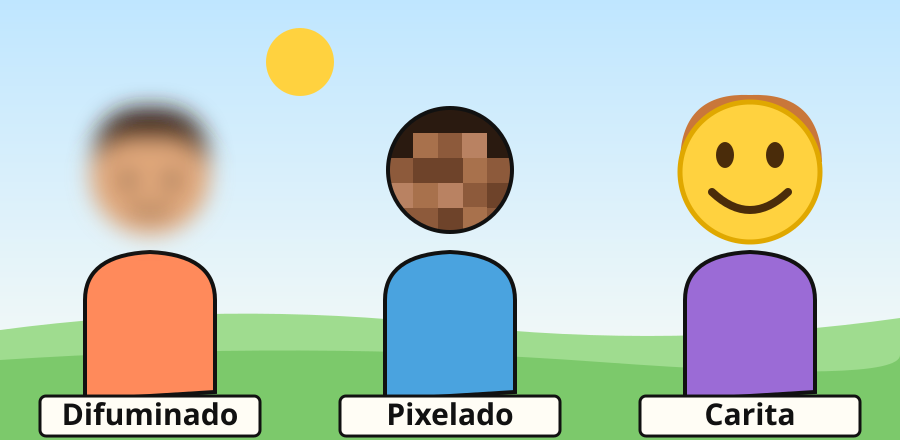

# Tapacaras

**A Spanish web page that covers the faces in a photo (blur, pixelate or a smiley) before you share it.
The photo never leaves the phone or computer: detection and covering run in the browser tab.**

**Use it: [marcelloavila.com/tapacaras](https://marcelloavila.com/tapacaras/)** (not published yet)

This drawing is what the page shows before a photo is chosen. There are no real screenshots: every test photo
so far shows a child, and those stay out of this repository.

## Run

Use the hosted version, or serve this folder (`python3 -m http.server`) and open `http://localhost:8000/`
in a recent Chrome, Edge, Firefox or Safari. It must be served, not opened from `file://`: the browser loads
the face model with `fetch`. No install, no account, no server code.

| Do | Action |
|----|--------|
| **Elegir foto** | Pick a photo; every face found is covered |
| Tap or click a face | Uncover it (a dashed outline stays so it can be covered again) |
| Drag over a spot | Cover a face the detector missed |
| **Tapar con** | Switch between *Difuminado* (blur), *Pixelado* and *Carita 🙂* |
| **Descargar foto** | Save a JPEG: covered faces, no outlines, no location or camera metadata |

Check every photo before sharing it: the detector misses faces in profile, upside down or very small.

## Privacy

- The page's Content-Security-Policy forbids sending data anywhere (`connect-src 'self'`) and loading code
  from other sites; `./selftest.sh` fails if that line changes.
- Once loaded, it works with the network off (tested with the network cut before choosing a photo).
- Visit counting (only "the page was opened", via a GoatCounter pixel, no cookies) is switched off until a
  GoatCounter code is set in `app.js`.

## Self-test

`./selftest.sh` checks the privacy rules, then runs `index.html#selftest` in headless Chrome, including the
real model, and prints `SELFTEST PASS` or what failed.

## Licence

MIT, see [LICENSE](LICENSE). Bundled: the YuNet face model (MIT, [models/LICENSE-yunet](models/LICENSE-yunet))
and ONNX Runtime Web (MIT, [vendor/LICENSE-onnxruntime](vendor/LICENSE-onnxruntime)).
How it was made: [PROMPT.md](PROMPT.md).
